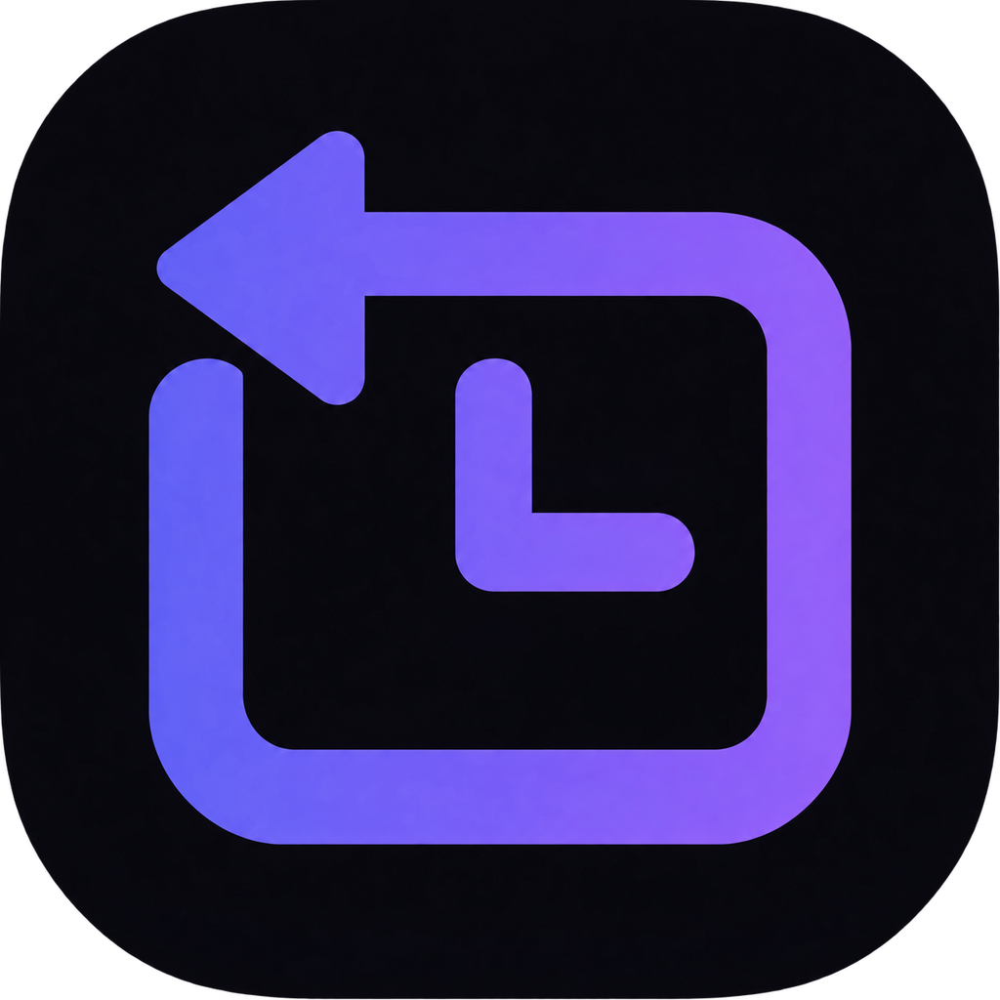

#  Rewinder — машина времени для окон Windows

**Запоминает, где и как были открыты твои окна, и возвращает их одной клавишей.**

## Что умеет

- **Undo для раскладки окон.** Каждое перемещение, разворачивание или сворачивание окна попадает в историю. `Ctrl + Alt + Z` открывает оверлей, где сразу выбран шаг назад для приложения, в котором ты работал. `Enter` возвращает окна на место.
- **Перезапуск закрытого приложения.** Если приложение закрыто, Rewinder запустит его с теми же аргументами и расставит окна по сохранённым позициям. Store/MSIX-приложения запускаются через их AppUserModelID.
- **Знает несколько приложений:**
  - **Проводник**: запоминает, какие папки были открыты, и открывает недостающие.
  - **Word, Excel, PowerPoint**: запоминают открытые документы и открывают их заново.
  - **Chrome, Edge, Brave, Vivaldi, Opera**: перезапускаются с тем же профилем и `--restore-last-session`.
- **Отмена отмены как надо.** Состояние, полученное восстановлением, помечается, поэтому следующее `Ctrl + Alt + Z` идёт дальше назад, а не туда-обратно.
- **Предпросмотр перед восстановлением**: миниатюра мониторов и окон у каждого снимка.
- **Именованные раскладки**: сохранить, где стоят все открытые приложения («Работа», «Стрим»), и вернуть всё одной кнопкой, из трея или по `Ctrl + Alt + 1…9`.
- **Отключили монитор — окна не теряются.** Окно, сохранённое на мониторе, которого больше нет, возвращается на основной.
- **Исключения**: любое приложение можно перестать отслеживать и удалить его историю.
- **История переживает перезагрузку**: 7 дней, до 500 снимков на приложение.
- **Права администратора не нужны.** Чтобы восстанавливать программы, запущенные от администратора, включи *Запускать от администратора* (UAC спросит один раз; автозапуск тогда идёт через Планировщик заданий).
- **Обновляется сам** из GitHub Releases: проверяет после запуска и каждые 6 часов, сверяет SHA-256 (и подпись, если релизы подписаны), заменяет exe и тихо перезапускается. Можно переключить на *спрашивать* или *выключить*.

## Чего не умеет

Rewinder восстанавливает **окна**, а не их **содержимое**: несохранённый текст, конкретные вкладки браузера на момент снимка или положение прокрутки он вернуть не может. Вкладки браузера восстанавливает сам браузер.

## Установка

1. Скачай `Rewinder.exe` из [релизов](../../releases).
2. Запусти. Rewinder живёт в системном трее.
3. Включи автозапуск в настройках, если нужно (при автозапуске окно не показывается).

## Управление

| Клавиша | Действие |
|---|---|
| `Ctrl + Alt + Z` | открыть оверлей для текущего приложения |
| `←` / `→` или колесо | шаг по истории |
| `Enter` | восстановить выбранный снимок |
| `Esc` | закрыть оверлей |

В главном окне (Timeline) можно выбрать любое приложение из истории, в том числе уже закрытое, и восстановить его.

## Приватность

- Хранятся только раскладка окон, их заголовки, пути открытых папок и Office-документов, командная строка запуска.
- Буфер обмена не читается.
- Менеджеры паролей (KeePass, KeePassXC, 1Password, Bitwarden) не отслеживаются.
- Всё хранится локально в `%LOCALAPPDATA%\Rewinder\history` и никуда не отправляется.

## Сборка

Нужны Go 1.23+, Node.js и [Wails CLI](https://wails.io) v2.11.

```bash
go install github.com/wailsapp/wails/v2/cmd/wails@v2.11.0
wails build
```

Генератор биндингов Wails 2.11 не работает с Go 1.25 и новее. Если у тебя свежий Go, собирай так: `GOTOOLCHAIN=go1.24.0 wails build`.

## Тесты

```bash
go test ./...
```

Интеграционные тесты открывают настоящие окна на рабочем столе, двигают их, закрывают и восстанавливают:

```bash
go test -tags integration ./...
```

## CI и релизы

- **CI** (`.github/workflows/ci.yml`, каждый push и pull request, Windows-раннер): gofmt, `go vet`, unit-тесты, `svelte-check`, сборка фронтенда, проверка, что `icons.ts` соответствует закреплённой версии Phosphor, интеграционные тесты на рабочем столе раннера (сообщают, но не блокируют) и артефакт `Rewinder.exe`.
- **Релиз** (`.github/workflows/release.yml`): запушь тег `vMAJOR.MINOR.PATCH` (с суффиксом `-beta.1` выйдет пре-релиз). Workflow вшивает версию в exe, собирает `Rewinder.exe` и установщик NSIS, подписывает оба, если настроен сертификат, пишет `SHA256SUMS.txt` и публикует GitHub Release. Встроенный апдейтер читает именно этот релиз.

  ```bash
  git tag v0.3.0
  git push origin v0.3.0
  ```
- **Подпись кода** необязательна. Добавь два секрета репозитория: `WINDOWS_CERT_PFX` (сертификат `.pfx` в base64) и `WINDOWS_CERT_PASSWORD`. Как только релизы подписаны, апдейтер отказывается ставить неподписанные сборки. Без сертификата Windows SmartScreen предупреждает при первом запуске; бесплатная подпись для open-source есть у [SignPath Foundation](https://signpath.org).
- **Dependabot** обновляет Go-модули, npm-пакеты и actions (Wails закреплён на 2.11).

## Структура проекта

```
main.go, app.go        точка входа Wails и методы, которые вызывает интерфейс
internal/
  winapi/              обёртки над Win32: окна, позиции, процессы, запуск, открытые файлы
  state/               снимает окна приложения в AppState
  snapshot/            история по приложениям: приём снимков, сравнение, запись на диск
  restore/             перезапуск и переоткрытие, сопоставление окон, расстановка
  plugins/             особенности приложений: браузеры, Проводник, Office
  events/              хук WinEvent: окно сдвинулось / показалось / получило фокус
  hotkey/, tray/       настраиваемый хоткей и значок в трее
  settings/            настройки, валидация, атомарная запись settings.json
  policy/              что отслеживать и сколько хранить
  services/            связывает всё вместе: цикл захвата, восстановление, пауза
frontend/src/
  App.svelte           выбирает экран и подписывается на события бэкенда
  ui/                  по папке на элемент: button, select, switch, slider, segmented,
                       dialog, tooltip, toast, kbd, avatar, search, swatch, empty, icon
  features/            шапка, приложения, история, оверлей, настройки (по папке на раздел)
  lib/                 состояние и вызовы Go: приложения, восстановление, настройки, хоткей
  i18n/                полные словари ru/en и стор языка
  theme/               токены, шрифты, reset и применение настроек внешнего вида
scripts/icons.mjs      вытаскивает иконки Phosphor (контур + заливка) в ui/icon/icons.ts
```

Интерфейс на Svelte 5, выпадающие списки, слайдеры, переключатели, подсказки и окно
настроек — на [bits-ui](https://bits-ui.com). Анимации меняют только `transform` и
`opacity`: WebView2 здесь рисует на CPU (его GPU-процесс отключён ради ~60 МБ памяти).

## Настройки и проверка

Настройки хранятся в `%LOCALAPPDATA%\Rewinder\settings.json`, выбранная картинка — рядом в `background.png`. Хоткей, язык, цвет, радиус, плотность, фон и анимации меняются в модальном окне настроек. Начальный язык соответствует языку интерфейса Windows (русский или английский; для остальных — английский).

Оверлей — компактное окно поверх остальных на мониторе с курсором. Кнопка «Открыть Rewinder» возвращает размер и позицию основного окна. Закрытие основного окна скрывает его в трей; «Выйти» завершает приложение.

`./scripts/verify.ps1` запускает обязательные проверки и на Windows — интеграционные тесты и сборку exe с Go 1.24.0. Нативный фокус и реальные хоткеи проверяются вручную: [отчёты этапов и ручная проверка](WORK_LOG.md).

У скрытого окна компоненты размонтированы, события снимков копятся до показа. Фронтенд не использует опросы; таймеры уведомлений останавливаются при скрытии. Размытие фона отрисовывается в статичную картинку при изменении параметров. Память процессов WebView2 Wails v2 при скрытии освободить не позволяет.

Иконки — встроенные SVG из [Phosphor Icons](https://github.com/phosphor-icons/core), MIT-лицензия сохранена рядом с путями.

## Если что-то не работает

Лог лежит в `%LOCALAPPDATA%\Rewinder\rewinder.log`. Приложи его к [issue](../../issues).

## Лицензия

MIT

---

**Автор**: lovly · **Версия**: 0.2.0
